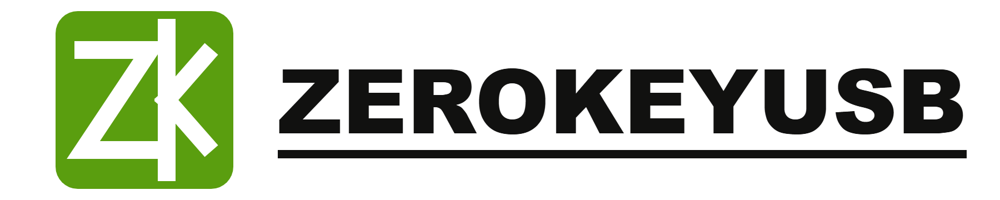
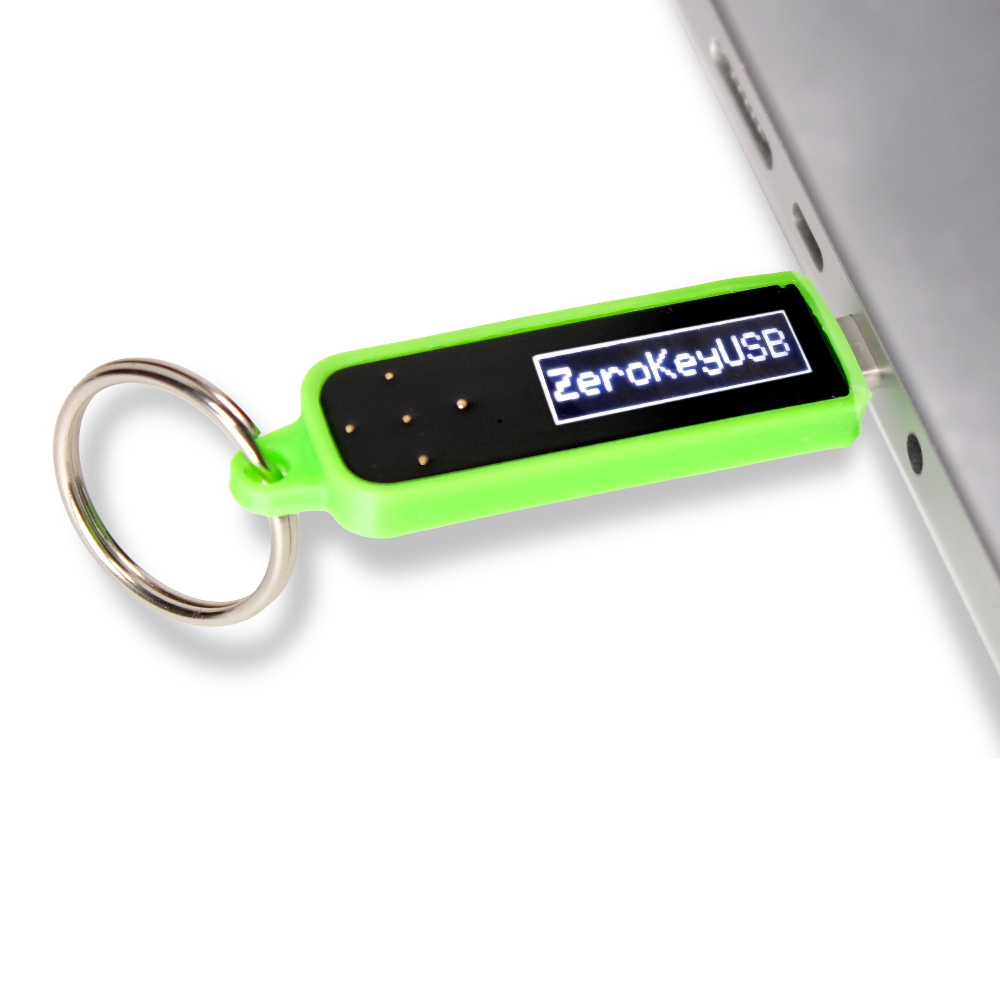
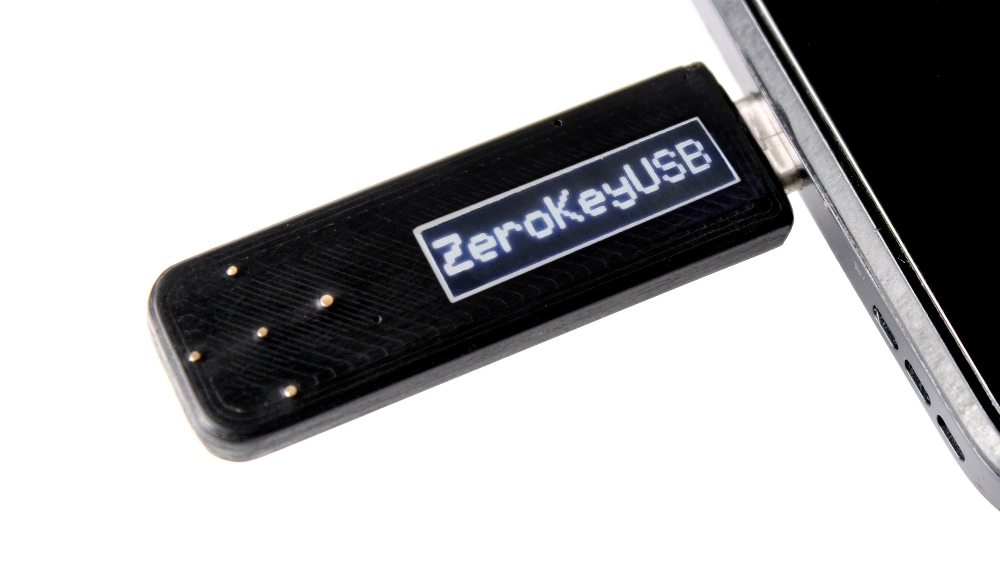
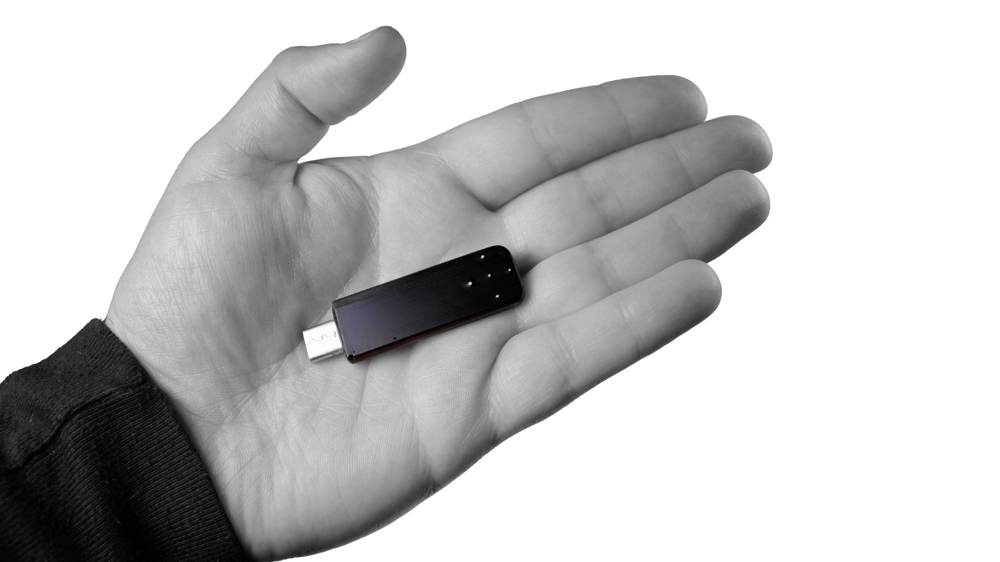

# ZeroKeyUSB — Kit de prensa

**Un gestor de contraseñas offline y de código abierto que llevas en el llavero.**
ZeroKeyUSB es un dispositivo USB-C que guarda tus credenciales y las teclea por ti. El ordenador lo ve como un teclado normal: sin nube, sin app, sin cuenta y sin suscripción.

🇬🇧 [English version](README.md)

  

## En resumen

| | |
|---|---|
| **Qué es** | Gestor de contraseñas físico. Se presenta como un teclado USB y escribe usuario, contraseña y código 2FA |
| **Capacidad** | 61 credenciales (sitio, usuario, contraseña de hasta 32 caracteres y secreto TOTP opcional) |
| **Seguridad** | PIN introducido en el propio dispositivo · elemento seguro ATECC608A · AES-128 · firmware firmado · sellado en resina |
| **Compatible con** | Windows, macOS, Linux, Android, iPadOS (USB-C). Sin instalar nada |
| **Código abierto** | Firmware, PCB y carcasa bajo licencia MIT: https://github.com/Depbit-lab/Zerokey |
| **Precio** | 99 $ en Crowd Supply (envío 8 $ EE. UU. / 18 $ internacional) |
| **Campaña** | Lanzada el 22 de septiembre de 2026 · supera el 250 % del objetivo · termina el **5 de noviembre de 2026** |
| **Entrega** | Prevista para abril de 2027 |
| **Origen** | Nació como trabajo de fin de grado en la Universidad de Cádiz, ganador del premio atrÉBT! TFG/TFM (XVI edición). Lo desarrolla Depbit LLC y se fabrica en España |

## Contenido del kit

| Carpeta | Contenido |
|---|---|
| [`press-releases/`](press-releases/) | Nota de prensa en español e inglés (Markdown y PDF) |
| [`ficha-tecnica.md`](ficha-tecnica.md) | Especificaciones completas: las cifras oficiales |
| [`faq.md`](faq.md) | Preguntas frecuentes (en inglés) |
| [`photos/web/`](photos/web/) | Fotos para web (≤ 2000 px) |
| [`photos/hi-res/`](photos/hi-res/) | Fotos originales en alta resolución (impresión) |
| [`logo/`](logo/) | Logo en SVG y PNG transparente, para fondo claro y oscuro, e icono |
| [`team/`](team/) | Biografía y foto del fundador |
| [`coverage.md`](coverage.md) | Dónde se ha publicado |

**Descargarlo todo:** botón verde **Code** → **Download ZIP**.

## Vídeo y enlaces

- Vídeo de demostración: https://www.youtube.com/watch?v=07VFlUV2yfk
- Campaña en Crowd Supply: https://www.crowdsupply.com/depbit/zerokeyusb
- Web y simulador en el navegador: https://zerokeyusb.com/
- Código fuente: https://github.com/Depbit-lab/Zerokey
- Instagram: https://instagram.com/zerokeyusb · X: https://x.com/zerokeyusb · TikTok: https://www.tiktok.com/@zerokeyusb

## Uso

Las fotos, logos y textos de este kit pueden usarse libremente, sin pedir permiso, para cualquier información periodística sobre ZeroKeyUSB. Agradecemos el crédito "ZeroKeyUSB". Por favor, no modifiquéis el logo.

## Contacto de prensa

**Bruno Escobar**, fundador
bruno@zerokeyusb.com · +34 644 460 313
Disponible para entrevistas en español e inglés, por correo o videollamada, con demostración en directo.
